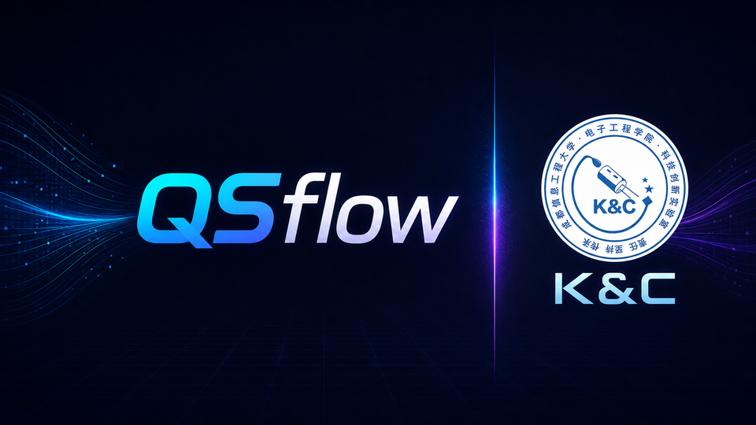

# QSflow



[](https://github.com/yulianQS/QSflow/actions/workflows/tests.yml)
[](LICENSE)
[](https://www.python.org/)

> Local-first AI-assisted object detection annotation desktop app. Supports
> Pascal VOC, YOLO Detection and COCO Detection with one unified annotation
> model, local inference, quick training and quality-control workflows.

QSflow 是本地 AI 辅助目标检测标注上位机。创建项目时可选择 Pascal VOC、YOLO Detection 或 COCO Detection；应用内部使用统一标注对象，人工标注、AI 推理、训练和质检操作一致。

项目坚持本地优先：图片和标注默认留在用户电脑，API 视觉质检是可选能力，
并且不会替代本地检测模型。

## 快速开始

Windows 用户可克隆或下载源码后直接双击 `启动_QSflow.bat`。首次启动会优先
复用兼容的本机 Python 环境；没有可用环境时才会创建项目内 `.venv`。

```powershell
git clone https://github.com/yulianQS/QSflow.git
cd QSflow
.\启动_QSflow.bat
```

> 仓库不包含模型权重和数据集。快速训练首次使用基础模型时，Ultralytics
> 会联网下载对应权重；也可以在 AI 助手中加载自己的模型。

## 已实现

- 创建或打开 Pascal VOC（`JPEGImages/` + `Annotations/`）、YOLO Detection（`images/` + `labels/`）和 COCO Detection（`images/` + `annotations/instances.json`）项目
- 导入单张/多张图片，或递归导入任意层级的图片素材文件夹
- 自动匹配图片与 XML，并显示未标注、AI 预测、人工确认状态
- 三栏界面：图片列表、标注画布、标注/AI/GPT 助手
- 鼠标拖动创建框，拖动框移动，拖动四角缩放，Delete 删除
- 滚轮缩放；按住 Ctrl + 左键拖动画布；A/D 切换图片
- VOC XML 读取和保存，保留可选的 `source` 与 `confidence` 字段
- 加载 Ultralytics `.pt` 模型，单图或批量自动标注
- 利用当前 VOC 标注进行轻量 YOLO 训练并自动加载 `best.pt`
- OpenAI 视觉辅助接口；API Key 只从环境变量读取
- 通用视觉模型 API 配置和一键标注质检，支持 Responses 与 OpenAI-compatible Chat Completions

## 安装与运行

### 推荐：双击 BAT 启动

直接双击：

```text
启动_QSflow.bat
```

启动器会依次检查项目 `.venv`、当前激活的 venv/Conda 环境、系统 Python 和 Windows Python Launcher。已有环境同时满足 Python 3.10–3.12 及项目依赖时会直接复用，并且不会修改该环境；只有找不到可用环境时，才会在项目目录创建 `.venv` 并安装依赖。如果项目环境损坏，可运行 `重装运行环境.bat`。

### 手动启动

建议使用 Python 3.10–3.12。在本目录打开 PowerShell：

```powershell
python -m venv .venv
.\.venv\Scripts\Activate.ps1
python -m pip install --upgrade pip
pip install -r requirements.txt
python app.py
```

也可直接打开一个 VOC 项目：

```powershell
python app.py "F:\path\to\VOC_Dataset"
```

项目必须至少包含：

```text
VOC_Dataset/
├── JPEGImages/
└── Annotations/
```

把图片复制到 `JPEGImages` 后重新打开项目即可扫描。XML 文件名默认与图片主文件名相同。

也可以直接使用工具栏“导入图片”或菜单“文件 → 导入图片文件夹（递归）”。程序会扫描所选文件夹及全部子文件夹，将支持的图片复制到 `JPEGImages`。同名但内容不同的图片会自动添加 `_1`、`_2` 后缀；内容完全相同的图片会跳过。

## 操作

- 在空白处按下左键并拖动：创建矩形框
- 拖动框内部：移动框
- 拖动选中框四角：缩放框
- `Delete`：删除选中框
- `Q` / `E`：把选中框切换到上一个 / 下一个类别
- `1`–`9`：把选中框直接切换到类别列表中对应序号的类别
- `Ctrl+S`：保存 XML
- `A` / `D`：上一张 / 下一张
- 鼠标滚轮：缩放图片
- `Ctrl + 左键拖动`：平移图片
- `X`：开启或关闭跟随鼠标的十字虚线定位辅助
- `V`：确认当前图片的全部 AI 标注框，虚线转为人工确认实线

不同类别使用稳定且不同的颜色；同一类别在整个项目中始终保持同色。人工框使用实线，AI 预测框使用虚线并显示置信度。切换图片时会自动保存。

检查一张 AI 标注图片无误后，可点击“确认当前图片标注”或在画布中按 `V`。所有 AI 虚线框会转为人工确认实线，图片状态变为“人工确认”，并立即保存 XML。

软件关闭时会记住窗口布局、上次项目、当前图片、筛选条件、当前类别、置信度和十字线状态。用户级配置保存在 Windows 当前用户的本地应用数据目录；每个项目的模型和界面状态保存在项目自己的 `.avls` 目录。分享源码或便携版时不会携带这些个人状态。

画布默认显示跟随鼠标的十字虚线，并在交点附近显示图片像素坐标。辅助线只在图片范围内绘制，不会写入图片或 VOC XML。

类别快捷键只在中间标注画布获得焦点时生效。先点击目标框将其选中，再按 `Q/E` 循环切换，或按数字键直接选择。通过快捷键修改过的 AI 框会变为人工确认框。

右侧“标注”页提供常驻的快捷键速查面板，打开软件即可查看完整鼠标操作和键盘操作。

“删除当前类别”会先统计该类别在整个项目中的使用情况。确认后，类别会从项目根目录的 `classes.txt` 中删除，所有使用该类别的标注框也会从相应 XML 中删除，但不会删除图片。

当焦点位于左侧图片列表时，按 `Delete` 会在确认后把当前图片及其 XML 从项目移除；当焦点位于中间画布时，`Delete` 仍然删除选中的标注框。移除的文件保存在 `<VOC根目录>/.avls/trash/时间戳/`，可以手动恢复。

## AI 使用

在右侧“AI助手”中先加载 Ultralytics 兼容 `.pt` 文件。单图推理会替换当前图片的框；批量推理只处理“未标注”图片，避免覆盖已有人工标注。

快速训练至少需要 2 张已标注图片。无需提前手动加载 `.pt`：没有当前模型时，软件默认自动下载并使用 `yolo11n.pt` 预训练权重；也可在 AI 助手中选择 YOLO11 Small 或 YOLOv8 Nano。首次下载需要联网，之后会使用本地缓存。如果已经手动加载自定义 `.pt`，则优先基于该模型继续训练。应用会在临时目录转换训练数据，训练结果保存到：

```text
<VOC根目录>/.avls/runs/quick_train/weights/best.pt
```

这是便捷入口，不是完整训练管理平台。

训练完成后生成的 `best.pt` 会自动成为当前模型。继续人工标注和确认 AI 结果后，再次点击快速训练，会以上一版 `best.pt` 为起点生成下一版模型；Ultralytics 自动使用 `quick_train-2`、`quick_train-3` 等目录保留历史版本。只有人工框或按 `V` 确认后的实线框会进入训练，未确认的 AI 虚线框会被排除。

训练会优先使用 NVIDIA CUDA GPU 0，只有 CUDA 不可用时才回退 CPU。“AI助手”会显示当前训练设备。RTX 显卡用户可运行 `安装_GPU_训练环境.bat` 安装项目专用 CUDA 12.6 PyTorch。

## GPT 视觉助手

先在启动应用的同一个 PowerShell 设置 Key：

```powershell
$env:OPENAI_API_KEY="你的 API Key"
python app.py
```

右侧“模型质检”支持配置服务名称、Base URL、模型名称、接口协议和 API Key 环境变量。可连接 OpenAI，也可连接提供 OpenAI-compatible Chat Completions 接口的第三方或本地视觉模型服务。

“一键检查当前图片标注”会把带编号标注框的图片、类别列表及框坐标发送给所选视觉模型，检查漏标、错类、框过松、框过紧、重复框和无效框。批量检查会对每张已标注图片分别发起一次 API 请求，执行前会提示可能产生费用。

“使用本机 Codex 一键质检”不需要 API Key。它调用已安装并登录的 Codex CLI，通过 `codex exec --image` 发送带编号框的临时图片，并用 JSON Schema取回报告；该方式消耗 Codex/ChatGPT 套餐内的 Codex 使用量。软件使用只读沙箱和临时会话，且要求本机 `codex` 命令可以正常执行。它不会自动控制 Codex 桌面窗口。

“本机 Codex 审查并一键确认”会在 Codex 报告无问题时自动执行人工确认并保存 XML；只要返回一个或多个疑似问题，就不会自动确认，必须人工修正。Codex 质检仍可能误判或漏判，重要数据建议人工抽查。

“本机 Codex 批量审查未确认图片”只处理 AI预测和质检有问题状态的图片。通过的图片会自动转为人工确认；存在问题的图片会显示为“质检有问题”，可从问题列表双击跳转。画布用红色虚线定位原框或建议框，同时输出带问题标记的图片和 JSON 报告到 `<VOC根目录>/.avls/review_issues/`。

质检界面按“API / 自定义视觉模型”和“本机 Codex”分组，避免重复按钮。模型批量审查可选择“仅未确认图片”或“所有已标注图片”，并使用页面中配置的 Base URL、模型名称和接口协议。已经确认的图片若审查出问题，会重新标记为“质检有问题”，且在修正确认前不进入下一轮训练。

“使用当前模型开始批量审查”默认只检查没有质检记录的已标注图片，因此导入新图片后不会重复检查旧图片。需要重新验证整个数据集时，可把范围切换为“重新审查全部已标注图片”。该功能使用当前加载模型和 GPU，按类别与 IoU 比较，不消耗 API/Codex Token，也不会自动修改标注。

左侧不再把“图片类型”和“检查动作”混在一个菜单里，而是分成两层。第一层是工作队列：`① 待检查（模型 / 人工任选）` → `② AI发现疑点，待人工处理` → `③ 人工已处理，待批量确认` → `✓ 检查流程已完成`。在①中可以使用模型检查，也可以人工查看当前图片后按 `V` 直接通过；确认已经人工看过左侧整批图片时，还可以批量人工通过。第二层“标注状态”只是可选筛选。修改已经检查完成的标注后，旧结论会自动失效并重新进入①。

“检查与质检”页为①提供三种选择：`①A 使用模型批量检查`、`①B 人工查看通过当前图片（V）`、`①C 批量人工通过左侧图片`。只有模型发现疑点时才会进入②；人工处理完疑点后进入③。批量人工通过会先显示图片数量并要求确认，避免误操作。

所有名称中带“左侧”的批量确认操作都严格以左侧当前可见列表为范围。左侧为空时不会处理全项目中的隐藏图片，也不会把已经完成的图片重复计入；需要操作时请先选择对应工作队列，并检查第二层“标注状态”是否把范围筛空。

质检敏感度默认使用“保守（少误报）”：不把模型漏检直接当作标注错误，只接受高置信度、非贴边的漏标候选，并提高错类判断门槛。若旧问题队列误报较多，点击“一键保守重筛现有问题队列”，无高可信问题的图片会批量进入`③ 待批量确认`，再点击③统一通过。个别模型高置信度误判可选中问题框后按 `R`，表示“原标注正确”；QSflow 会保留原框并记住该误报，今后重新审查时不再重复提示。

模型加载支持 Ultralytics 可识别的主流检测格式，包括 PyTorch `.pt`、ONNX `.onnx`、TensorFlow Lite `.tflite`、TensorRT `.engine`、TorchScript `.torchscript`、CoreML `.mlpackage` 等。具体格式能否在本机推理还取决于对应运行时是否已安装。

OpenART 自定义 YOLOv3 TFLite 已提供专用适配：QSflow 会读取模型真实输入尺寸和 int8 量化参数，并从模型同目录的 `config.cfg`、`yolo3_anchors.txt` 自动取得类别、anchors 和 NMS 阈值。电脑端质检应加载不带后处理的 `yolo3_iou_smartcar_final.tflite`。文件名含 `with_post_processing` 的版本包含 OpenART 设备自定义算子，只用于设备部署，电脑端 LiteRT 无法直接执行，QSflow 会给出明确提示。

QSflow 会记住窗口布局、面板宽度、当前 Tab、置信度、训练基础模型、审查范围、最近项目和模型；每个项目还会单独记住最后图片、筛选条件、当前类别和工作 Tab。

用户配置不再写入软件目录，而是保存在 Windows 当前用户的本地应用数据目录中；不同电脑、不同 Windows 用户互不影响。每个项目会独立记住自己的模型，切换项目不会错误沿用上一个项目的检测模型。项目首次打开时会建立 `.avls/image_index.json` 图片尺寸缓存，之后只重新读取新增或已修改图片。

未捕获异常和后台任务错误会写入轮转诊断日志。可在“帮助 → 打开诊断日志目录”查看，便于远程排查其他电脑上的启动或模型问题；日志不会保存 API Key。

## 制作分享版

双击 `制作分享版.bat`，会在 `dist/QSflow-portable` 生成干净副本。分享包不包含 `.venv`、缓存、个人最近路径、API 配置、数据集、运行日志或项目 `.avls` 状态。请压缩并发送整个 `QSflow-portable` 文件夹，不要只发送 BAT 或 `app.py`。

## 开源许可

QSflow 以 [GNU AGPL-3.0-or-later](LICENSE) 发布。运行时依赖的第三方项目
仍遵循各自许可证，详见 [NOTICE](NOTICE)。仓库不分发数据集或模型权重。

QSflow 使用 Ultralytics 时，整个项目必须满足其 AGPL 开源条件；闭源、商业、
内部工具、硬件嵌入等使用场景可能需要 Ultralytics Enterprise License。发布者和
使用者应自行核对 [Ultralytics 官方许可页面](https://www.ultralytics.com/license)。

“一键确认 AI预测非可疑图片”会自动处理全部 AI预测图片：已质检通过的直接确认；尚未质检的先使用当前 `best.pt` 和 GPU 审查，无疑点则确认，有疑点则转为“质检有问题”并输出定位报告。该功能不消耗 API/Codex Token。

在“质检有问题”队列中修正或驳回问题框后，图片会显示 `☑`，表示已经人工复核过。标记会保存在项目中，关闭软件后仍会恢复。修完当前图片最后一个问题时，软件会继续跳到下一张仍有问题的图片；已修正图片继续留在质检列表中。点击“一键确认人工已复核图片”可将所有带 `☑` 且没有剩余问题的图片统一转为“人工确认”；仍有问题的图片不会被误确认。

问题框可以直接处理：在画布中点击红色问题框（选中后变黄色），从“标注”页选择类别，再点击“将所选问题框应用为当前类别”。如果问题对应现有框，会修改该框类别；如果是疑似漏标建议框，会直接按建议坐标创建新框。处理后该问题从列表移除并立即保存 XML。

选中问题框后可直接使用类别快捷键：`Q/E` 选择上一类或下一类并立即确认，`1–9` 精确选择对应序号类别并立即确认，`Enter` 使用下拉框中的当前类别确认。每次确认都会处理并移除当前问题提示。

问题框还支持：`W` 直接采用模型推荐类别并确认；`Delete` 删除问题。若问题关联现有标注框，Delete 会删除该标注框；若问题是疑似漏标建议，Delete 只驳回该建议，不会创建或删除其他标注。

如果当前处于“质检有问题”筛选，处理完一张图片的最后一个问题后会保持该筛选，并自动加载队列中的下一张问题图片，便于连续使用 Q/E、W、Delete。问题全部处理完成后会保留空的问题筛选并显示完成提示。

API Key 输入框只在本次运行期间保留，不会写入磁盘；其余 API 配置保存在 Windows 当前用户的本地应用数据目录。也可以使用配置的环境变量提供 Key。质检只生成内部报告，不会自动修改标注文件，最终结果需要人工确认。

## 测试

```powershell
pip install pytest
pytest -q
```

## 代码结构

```text
ai/       YOLO 推理、快速训练、GPT 视觉接口
core/     Project、ImageItem、AnnotationBox 统一数据模型
ui/       三栏主窗口与标注画布
voc/      Pascal VOC 扫描、读取与保存
config/   配置示例
tests/    VOC 往返测试
```

注意：标准 VOC 工具会忽略 XML 中额外的 `source` 和 `confidence` 节点，因此仍保持兼容。如果你的下游解析器要求极严格，可在后续增加“纯 VOC 导出”开关。
